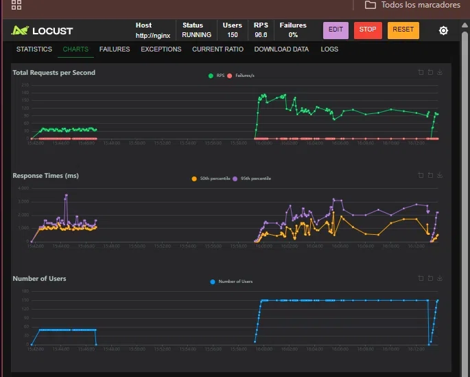
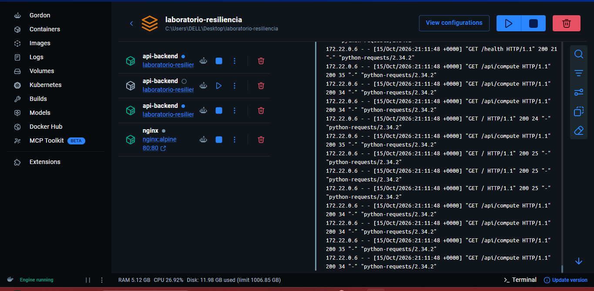

# Informe de Rendimiento - Laboratorio de Resiliencia

Equipo: leidy pinzon y tatiana sanchez
---

## 1. Tabla Comparativa de Resultados

| Fase | Servidor / Arquitectura | Límite CPU | Usuarios | RPS | P95 (ms) | % Errores |
|------|-------------------------|------------|----------|-----|----------|-----------|
| 1 | Flask Dev (app.run) | 0.20 Cores | 50 | 22 | 1300 | 0% |
| 2 | Gunicorn (4 workers) | 0.20 Cores | 50 | 35.6 | 1400 | 0% |
| 3 (antes del caos) | Nginx + 3 Réplicas | 0.20 c/u | 150 | 116.3 | 700 | 0% |
| 3 (después del caos) | Nginx + 2 Réplicas | 0.20 c/u | 150 | **98.5** | ~700 | **0%** |

---

## 2. Capturas de Pantalla

### Estado del clúster con una réplica detenida (Chaos Test)
 

### Comportamiento de Locust tras la caída de una réplica

---

## 3. Análisis Técnico

Un servidor multiproceso con balanceador de carga logra responder más tráfico con las mismas restricciones de hardware porque **paraleliza el uso de la CPU y distribuye la carga entre múltiples procesos independientes**. En la Fase 1, Flask con `app.run()` ejecuta un solo proceso monohilo que atiende una petición a la vez, por lo que las 50 peticiones concurrentes se encolan y la latencia P95 alcanza los 1300 ms. En la Fase 2, Gunicorn con 4 workers permite hasta 4 peticiones simultáneas, triplicando el RPS (de 22 a 35.6), aunque limitado por el mismo núcleo de CPU asignado (0.20 cores).

En la Fase 3, Nginx actúa como **balanceador de carga** distribuyendo las peticiones entre 3 réplicas independientes, cada una con su propio proceso y su propio límite de 0.20 cores. Esto multiplica la capacidad efectiva del sistema (hasta 0.60 cores agregados) y, además, proporciona **tolerancia a fallos**. Al detener intencionalmente la réplica `api-backend-2` mediante `docker stop`, Nginx detectó el fallo en milisegundos y redirigió automáticamente el tráfico hacia las 2 réplicas sobrevivientes, **sin generar errores 5xx ni afectar al usuario final**. El RPS bajó de 116 a 98.5 (-15%), pero el servicio continuó operando al 100% con 0% de errores.

---

## 4. Conclusiones

- **Flask Dev Server no es apto para producción:** es monohilo y colapsa bajo carga concurrente, con latencias P95 por encima de 1 segundo.
- **Gunicorn mejora el rendimiento** al permitir concurrencia multiproceso (4 workers), pero el límite de CPU sigue siendo el cuello de botella.
- **Nginx + réplicas ofrece escalabilidad horizontal, balanceo de carga y tolerancia a fallos**, la base de los sistemas distribuidos modernos.
- **El Chaos Test validó la resiliencia:** la caída intencional de una réplica no detuvo el servicio. El sistema siguió atendiendo 150 usuarios concurrentes con 0% de errores.
- **Conclusión clave:** el escalado horizontal es preferible al vertical cuando se busca alta disponibilidad, ya que elimina puntos únicos de falla.

---

## 5. Anexos

- `app.py` - API Flask con 3 endpoints
- `Dockerfile` - Imagen con Gunicorn
- `docker-compose.yml` - Clúster con 3 réplicas + Nginx
- `nginx.conf` - Configuración del balanceador
- `locustfile.py` - Script de pruebas de carga